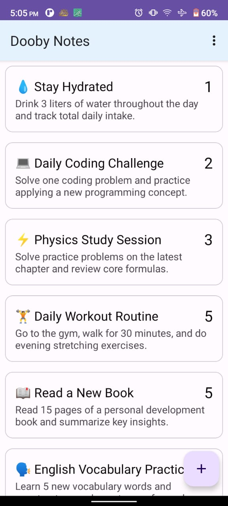
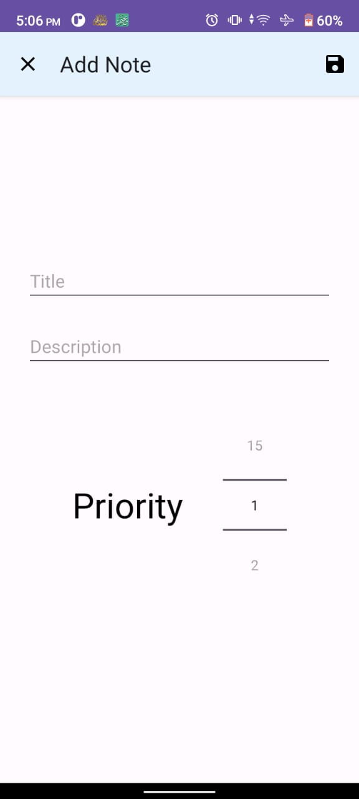
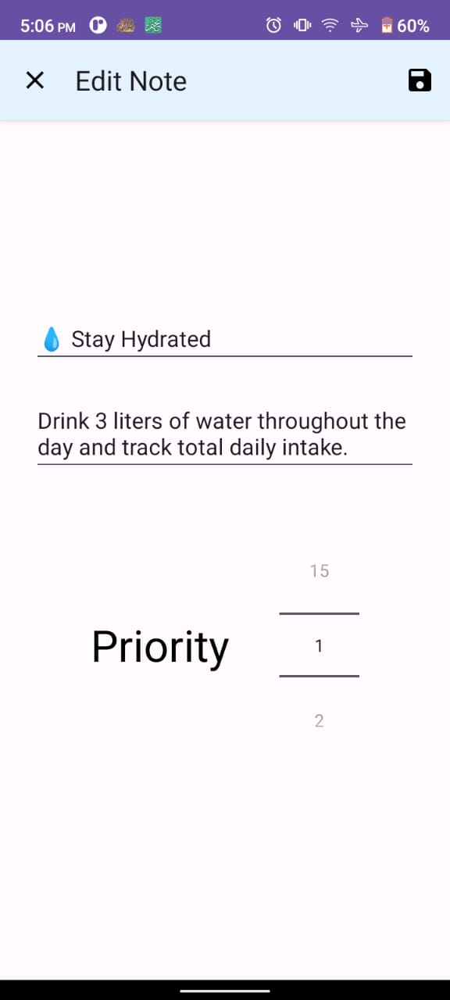
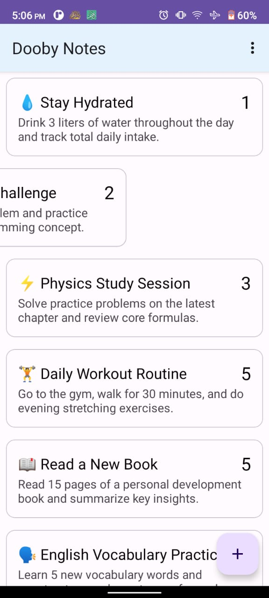
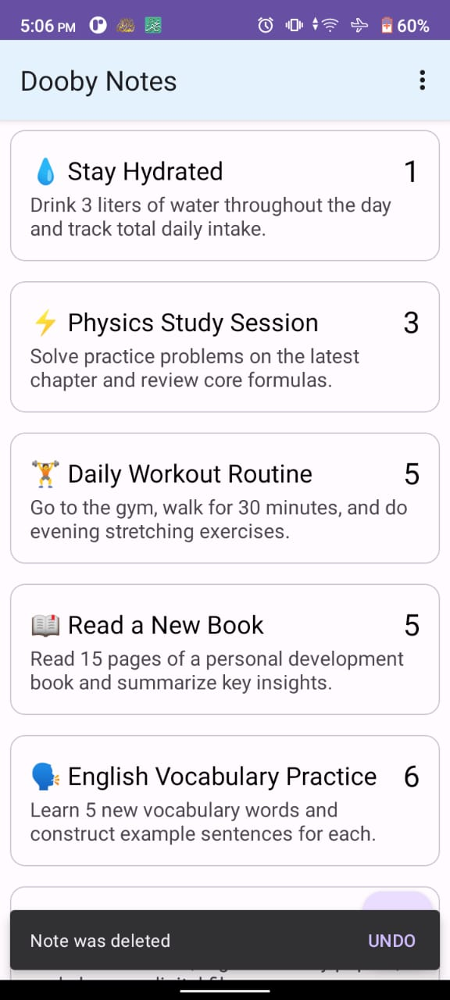
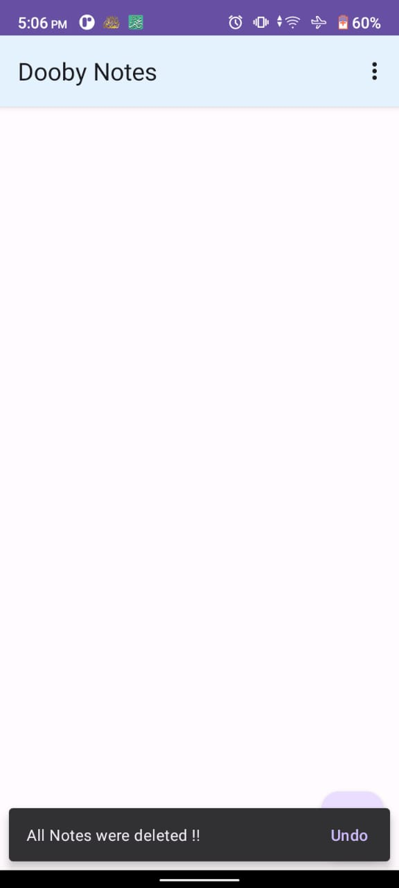

# 📝 Notes App

A very simple Android notes application built with Kotlin and XML, created mainly as a practical exercise to apply **MVVM architecture** and **RecyclerView**.

## 📱 Features

* **View Notes:** Display all saved notes in a RecyclerView.
* **Add Notes:** Create new notes with a title, description, and priority.
* **Edit Notes:** Update existing notes whenever needed.
* **Swipe to Delete:** Swipe a note left or right to delete it.
* **Undo Delete:** Restore a deleted note using the Undo action.
* **Delete All Notes:** Delete all saved notes at once.
* **Priority Selection:** Assign a priority level to each note.

## 🛠 Technologies Used

* Kotlin
* Android Studio
* XML Layouts
* MVVM Architecture
* RecyclerView
* ListAdapter & DiffUtil
* Room Database
* LiveData
* ViewModel & Coroutines

## 📸 Screenshots

| Main Screen | Add Note | Edit Note |
| :---: | :---: | :---: |
|  |  |  |

| Swipe to Delete | Undo Delete | Delete All Notes |
| :---: | :---: | :---: |
|  |  |  |

## 📥 Download APK

🚀 **[Click Here to Download Notes App APK](apk/Notes_app.apk?raw=true)**

## 👨‍💻 Developer

**Abdelrhman Yasser**